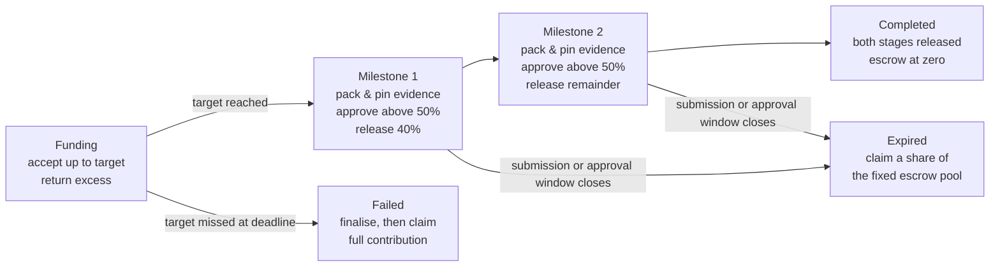

# MilestoneFund

**Pay for proof, one milestone at a time.**

MilestoneFund is a decentralised crowdfunding application for small projects with two defined deliverables. Backers fund an on-chain escrow before any work is reviewed; the creator packs the deliverables into a content-addressed IPFS archive, and funds are released only after a weighted backer vote against the on-chain content digest. If the funding target is missed or a submission or approval window closes, the contract automatically opens refunds — no owner key, no admin, and no platform fees.

- **Live application:** <https://misaka10111.github.io/dapp/>
- **Sepolia contract (v1.0 course release):** [`0x5A5A…964F`](https://sepolia.etherscan.io/address/0x5A5AeaE5553Feb5c5b27FEe5ec8b24E3ED2B964F) (chain ID 11155111, URL-based evidence)
- **Demo video:** <https://youtu.be/k94OegfoAOg>
- **Source code:** <https://github.com/misaka10111/dapp>

The v1.0 release is preserved at the Git tag `v1.0`. The current mainline replaces its mutable evidence URLs with IPFS content identifiers; see [IPFS evidence](#ipfs-evidence) and [`docs/ipfs-evidence.md`](docs/ipfs-evidence.md).

## Contents

- [Features](#features)
- [How it works](#how-it-works)
- [IPFS evidence](#ipfs-evidence)
- [Smart contract design](#smart-contract-design)
- [Frontend and wallet integration](#frontend-and-wallet-integration)
- [Technology stack](#technology-stack)
- [Project structure](#project-structure)
- [Getting started](#getting-started)
- [Configuration](#configuration)
- [Testing](#testing)
- [Deployment and reproducibility](#deployment-and-reproducibility)
- [Design limitations](#design-limitations)
- [License](#license)

## Features

1. **Escrow custody.** Every contribution is held by the contract itself. Funds never sit in the creator's wallet, and the contract has no owner, no admin role and no platform fees.
2. **Content-addressed evidence.** For each milestone the creator's files are packed in the browser into a deterministic UnixFS archive and pinned through a lightweight relay. The contract stores only the 32-byte SHA-256 digest, so evidence cannot be silently altered after submission.
3. **Strict majority rule.** A milestone passes only when approving weight is strictly above 50% of the total raised. Two equal backers each hold exactly 50%, so both votes are required.
4. **Contribution cap.** A contribution accepts at most the amount still needed to reach the target. Any excess is returned in the same transaction, and funding closes automatically once the target is met.
5. **Staged 40% / 60% allocation.** The first milestone releases 40% of the funds, rounded down to a whole wei; the second releases the remaining escrow, including the rounding remainder, so no wei is lost.
6. **Automatic refunds.** A missed funding target lets backers reclaim their full recorded contributions; a missed submission or approval window opens proportional refunds of the remaining escrow.
7. **Time-bound windows.** Windows are measured by the block timestamp. A transaction must be included in a block before its deadline; the v1.0 deployment uses 600-second windows set through the constructor.

## How it works



The target, deadline and two milestone goals are fixed after creation. The creator's address cannot contribute to its own project, and every repeat operation (duplicate contribution, vote, submission or withdrawal) reverts.

## IPFS evidence

The evidence pipeline runs entirely on content-addressed data, with a minimal relay that never sees the pinning credentials in the browser:

1. **Local packaging.** The browser reads the selected files and a written summary, builds a fixed-parameter UnixFS directory (dag-pb, links sorted by name, 256 KiB leaf chunks) and exports a CAR with a single root CID.
2. **Deterministic digest.** The CID uses the standard multihash prefix `0x1220` (SHA-256) followed by 32 digest bytes. The same inputs always produce the same CID; the on-chain field is a `bytes32` holding exactly those 32 bytes.
3. **Pinning relay.** A Cloudflare Worker receives the CAR plus an `x-evidence-digest` header, verifies that the CAR root matches the header and that every block is present, then forwards it to the pinning service using a server-side secret. A mismatched or malformed CAR is rejected before any pinning quota is spent.
4. **Verification.** The UI can fetch the archive from public gateways, recompute every hash and report a match against the on-chain digest; a single changed byte fails the check.

CID versions are interchangeable views of the same digest: CIDv0 is the base58btc form (`Qm…`) and CIDv1 is the base32 form (`bafy…`). The full math, packaging parameters and operator runbook are in [`docs/ipfs-evidence.md`](docs/ipfs-evidence.md).

## Smart contract design

The contract is `contracts/MilestoneFund.sol` (Solidity ^0.8.24). Any number of projects share one contract, each with isolated accounting:

- `totalRaised` records historical funding and supplies the denominator for approval and refund calculations.
- `escrowBalance` tracks the funds still held for the project; `claimablePayouts` tracks allocations released for later collection.
- Each milestone carries a `bytes32 evidenceCid` alongside its goal, vote and release state.
- Per-backer mappings record contributions, votes and claimed refunds by wallet address.

**Voting and allocation.** Voting weight equals the ETH accepted from each backer, and a milestone passes iff approving weight is strictly greater than 50% of `totalRaised`. The first payout is `floor(2 × totalRaised / 5)` — exactly 40% rounded down to a whole wei. The second payout is the remaining escrow balance, which carries the rounding remainder so the escrow ends at zero.

**Release paths.** `releaseMilestone` can be called by any account and credits the creator's claimable balance; the creator later collects it with `claimPayout`, which supports an arbitrary recipient address. The direct path releases an approved stage and receives its allocation in a single transaction. If a recipient cannot receive ETH, the transaction reverts and the creator can nominate another address.

**Refund math.** When funding fails, backers reclaim their full recorded contributions. When a stage expires, the first successful refund claim fixes the remaining escrow as the refund pool; each share is `contribution × pool / totalRaised`, rounded down to a whole wei. Every eligible backer uses the same fixed pool, so the order of claims never changes anyone's amount, and unallocated dust stays in the escrow ledger.

**Security.** All ETH-sending functions are protected by a custom `nonReentrant` guard, and accounting is updated before any external transfer (checks–effects–interactions). The contract has neither `receive` nor `fallback`, so forced ETH cannot enter it or distort balances.

## Frontend and wallet integration

The web app uses React with Vite as the build tool and Ethers.js for contract calls and ETH/wei conversion.

- A `JsonRpcProvider` against a public Sepolia RPC handles the read-only path; a `BrowserProvider` with MetaMask handles signed transactions.
- The interface validates the selected chain and account before requesting a signer, and exposes wallet confirmation and pending states. Refreshes read funding, milestone and refund figures from the same block number so the views stay consistent.
- The read functions `getMilestoneWindow` and `getExpiredRefundAmount` drive the deadline indicators and refund amounts shown in the UI.
- The Vite build splits vendor code into separate `ethers`, `react` and `ipfs` chunks so no chunk exceeds the 500 KB warning threshold.

## Technology stack

| Layer | Technologies |
| --- | --- |
| Smart contract | Solidity 0.8.24, custom reentrancy guard, bytes32 content digest, no external dependencies |
| Content addressing | multiformats, @ipld/dag-pb, @ipld/car, ipfs-unixfs; UnixFS/CAR packaging in the browser |
| Pin relay | Cloudflare Worker, Pinata v3 pinning adapter, CORS allow-list, optional shared key |
| Frontend | React 19, Vite 7, Ethers.js 6 |
| Wallet | MetaMask (EIP-1193), Ethereum Sepolia |
| Testing | Node.js built-in test runner, EthereumJS VM, in-process signed transactions |
| CI/CD | GitHub Actions quality gate, GitHub Pages deployment, Worker deploy workflow |

## Project structure

| Path | Purpose |
| --- | --- |
| `contracts/MilestoneFund.sol` | Core contract: project creation, contributions, votes, releases and refunds |
| `src/App.jsx` | Views, wallet connection and transaction buttons |
| `src/ipfs.js` | UnixFS packaging, CAR export, CID/digest conversion, gateways and verification |
| `src/relay.js` | Frontend pin-relay client with typed relay errors |
| `src/EvidenceForm.jsx` | Two-step file upload: package and pin, then record the digest on-chain |
| `src/EvidenceView.jsx` | CID display, gateway links and in-browser content verification |
| `src/contract.js` | Reads contract configuration, sets up providers and loads the ABI |
| `src/utils.js` | Amount formatting, percentages and error messages |
| `src/abi/MilestoneFund.json` | ABI kept in sync with the current contract |
| `worker/` | Pin relay: Worker entry point, pinning adapter and Wrangler configuration |
| `scripts/compile-contract.mjs` | Recompiles the contract and regenerates the ABI |
| `scripts/verify-deployment.mjs` | Read-only bytecode verification with evidence output |
| `scripts/check-format.mjs` | Dependency-free formatting checks |
| `tests/` | Continuous-state contract tests, IPFS and relay tests, unit tests and a fake EIP-1193 wallet |
| `.github/workflows/ci.yml` | Quality gate on PRs and Pages deployment on `main` |
| `.github/workflows/deploy-worker.yml` | Deploys the pin relay when `worker/**` changes |
| `vite.config.js` | React plugin and manual vendor chunk splitting |

## Getting started

Requires Node.js 22.12 or later (npm is included). No database, backend server or Hardhat setup is needed.

```bash
git clone https://github.com/misaka10111/dapp.git
cd dapp
npm ci
cp .env.example .env.local   # then fill in the values below
npm run dev
```

The development server runs at <http://localhost:5173>. To interact with the contract, connect MetaMask on the Ethereum Sepolia network and keep some test ETH for gas.

| Command | Description |
| --- | --- |
| `npm run dev` | Start the development server |
| `npm test` | Run the full automated test suite |
| `npm run build` | Produce the static production build in `dist` |
| `npm run verify:deployment` | Verify the live Sepolia bytecode (network access required) |
| `npm run compile:contract` | Recompile the Solidity contract and update the ABI |
| `npm run format:check` | Run formatting checks |
| `npm run worker:dev` | Run the pin relay locally with `worker/.dev.vars` secrets |
| `npm run worker:deploy` | Deploy the pin relay with Wrangler |

## Configuration

Configuration is read from `.env.local`, which is git-ignored. Only public values belong in `VITE_*` variables because they are embedded in the browser build.

| Variable | Purpose |
| --- | --- |
| `VITE_CONTRACT_ADDRESS` | Deployed Sepolia contract address; point this at the v2 contract after deployment |
| `VITE_SEPOLIA_RPC_URL` | Optional public HTTPS RPC for read-only browsing; when empty, reads go through MetaMask |
| `VITE_PIN_RELAY_URL` | Base URL of the pin relay Worker; evidence submission is disabled without it |
| `VITE_PIN_RELAY_KEY` | Optional shared key sent as the `x-relay-key` header |

Worker secrets are configured separately with Wrangler and never reach the browser: `PINATA_JWT` (a pin-only scoped token) and the optional `RELAY_KEY`.

## Testing

```bash
npm test
```

The suite contains **149 tests, all passing** across 21 suites. Contract tests deploy the contract inside an in-process EthereumJS VM and drive continuous state with signed transactions — no MetaMask, RPC or test ETH required — under two compilation profiles that reproduce both the repository build and the live deployment. Dedicated IPFS tests cover deterministic packaging, known CID vectors and tamper detection, including cross-implementation vectors against `ipfs-unixfs-importer`, while relay tests mock the network for every success and failure branch. A `PaymentReceiver` fixture asserts that a rejected ETH transfer rolls the whole transaction back.

## Deployment and reproducibility

The v1.0 contract was deployed on Ethereum Sepolia at [`0x5A5A…964F`](https://sepolia.etherscan.io/address/0x5A5AeaE5553Feb5c5b27FEe5ec8b24E3ED2B964F), with 600-second submission and approval windows set through the constructor. Its source is preserved at the `v1.0` tag, and the current contract is a new deployment at a fresh address rather than an upgrade of the old one.

GitHub Actions runs the quality gate (format check, tests, production build) on every pull request and publishes the Vite build to GitHub Pages when `main` passes. A separate workflow deploys the pin relay when files under `worker/` change, using a Wrangler API token stored as a repository secret.

`npm run verify:deployment` is a read-only check that compares the on-chain runtime bytecode with a fresh compilation. Because Solidity `immutable` constructor values occupy zero placeholders in the compiled artifact, the tool performs explicit immutable substitution and reports one of three statuses:

- `full-match` — bytecode identical including metadata;
- `immutable-substitution-match` — identical after substituting constructor values (the v1.0 live result);
- `executable-only-match` — executable code matches but metadata differs.

Reproducible evidence (runtime hex, standard input JSON and metadata) is written under `docs/evidence/deployment/`. The end-to-end operator runbook — pinning account, Worker secrets, contract deployment and verification — is in [`docs/ipfs-evidence.md`](docs/ipfs-evidence.md).

## Design limitations

- A CID proves that content has not been tampered with; it does not prove authorship, legitimacy or that the deliverable meets the milestone's goal. Backers still make that judgement.
- Public gateways and pinning services are external infrastructure: gateways can be slow or unreachable, and long-term availability depends on active pinning.
- A backer supplying more than half the funding can approve a milestone alone.
- The contract supports two fixed stages and has no separate on-chain dispute resolution process.
- The client-side manifest timestamp is informational only; the authoritative time is always the block timestamp.
- React component-level regression tests are not yet wired in; the test helpers already include a reusable fake wallet for that purpose.

## License

Released under the [MIT License](LICENSE).
