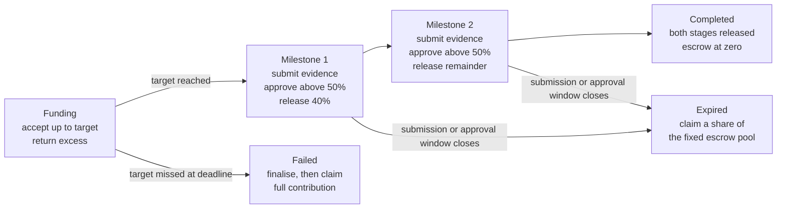

# MilestoneFund

**Pay for proof, one milestone at a time.**

MilestoneFund is a decentralised crowdfunding application for small projects with two defined deliverables. Backers fund an on-chain escrow before any work is reviewed; the creator submits evidence for each milestone, and funds are released only after a weighted backer vote. If the funding target is missed or a submission or approval window closes, the contract automatically opens refunds — no owner key, no admin, and no platform fees.

- **Live application:** <https://misaka10111.github.io/dapp/>
- **Sepolia contract:** [`0x5A5A…964F`](https://sepolia.etherscan.io/address/0x5A5AeaE5553Feb5c5b27FEe5ec8b24E3ED2B964F) (chain ID 11155111)
- **Demo video:** <https://youtu.be/k94OegfoAOg>
- **Source code:** <https://github.com/misaka10111/dapp>

Built as the COMP7610 (Introduction to Web3 and Blockchain) final project at The University of Hong Kong.

## Contents

- [Features](#features)
- [How it works](#how-it-works)
- [Smart contract design](#smart-contract-design)
- [Frontend and wallet integration](#frontend-and-wallet-integration)
- [Technology stack](#technology-stack)
- [Project structure](#project-structure)
- [Getting started](#getting-started)
- [Configuration](#configuration)
- [Testing](#testing)
- [Deployment and reproducibility](#deployment-and-reproducibility)
- [Design limitations](#design-limitations)
- [License](#license)

## Features

1. **Escrow custody.** Every contribution is held by the contract itself. Funds never sit in the creator's wallet, and the contract has no owner, no admin role and no platform fees.
2. **Evidence-based milestone votes.** For each milestone the creator records a written summary and a URL to the deliverable. Backers then vote, with weight equal to the ETH the contract accepted from them.
3. **Strict majority rule.** A milestone passes only when approving weight is strictly above 50% of the total raised. Two equal backers each hold exactly 50%, so both votes are required.
4. **Contribution cap.** A contribution accepts at most the amount still needed to reach the target. Any excess is returned in the same transaction, and funding closes automatically once the target is met.
5. **Staged 40% / 60% allocation.** The first milestone releases 40% of the funds, rounded down to a whole wei; the second releases the remaining escrow, including the rounding remainder, so no wei is lost.
6. **Automatic refunds.** A missed funding target lets backers reclaim their full recorded contributions; a missed submission or approval window opens proportional refunds of the remaining escrow.
7. **Time-bound windows.** The live deployment gives each submission and approval window 600 seconds, measured by the block timestamp. A transaction must be included in a block before its deadline.

## How it works



The target, deadline and two milestone goals are fixed after creation. The creator's address cannot contribute to its own project, and every repeat operation (duplicate contribution, vote, submission or withdrawal) reverts.

## Smart contract design

The contract is `contracts/MilestoneFund.sol` (Solidity ^0.8.24). Any number of projects share one contract, each with isolated accounting:

- `totalRaised` records historical funding and supplies the denominator for approval and refund calculations.
- `escrowBalance` tracks the funds still held for the project; `claimablePayouts` tracks allocations released for later collection.
- Per-backer mappings record contributions, votes and claimed refunds by wallet address.

**Voting and allocation.** Voting weight equals the ETH accepted from each backer, and a milestone passes iff approving weight is strictly greater than 50% of `totalRaised`. The first payout is `floor(2 × totalRaised / 5)` — exactly 40% rounded down to a whole wei. The second payout is the remaining escrow balance, which carries the rounding remainder so the escrow ends at zero.

**Release paths.** `releaseMilestone` can be called by any account and credits the creator's claimable balance; the creator later collects it with `withdrawMilestone`, which supports an arbitrary recipient address. The direct path releases an approved stage and receives its allocation in a single transaction. If a recipient cannot receive ETH, the transaction reverts and the creator can nominate another address.

**Refund math.** When funding fails, backers reclaim their full recorded contributions. When a stage expires, the first successful refund claim fixes the remaining escrow as the refund pool; each share is `contribution × pool / totalRaised`, rounded down to a whole wei. Every eligible backer uses the same fixed pool, so the order of claims never changes anyone's amount, and unallocated dust stays in the escrow ledger.

**Security.** All ETH-sending functions are protected by a custom `nonReentrant` guard, and accounting is updated before any external transfer (checks–effects–interactions). The contract has neither `receive` nor `fallback`, so forced ETH cannot enter it or distort balances.

## Frontend and wallet integration

The web app uses React with Vite as the build tool and Ethers.js for contract calls and ETH/wei conversion.

- A `JsonRpcProvider` against a public Sepolia RPC handles the read-only path; a `BrowserProvider` with MetaMask handles signed transactions.
- The interface validates the selected chain and account before requesting a signer, and exposes wallet confirmation and pending states. Refreshes read funding, milestone and refund figures from the same block number so the views stay consistent.
- The read functions `getMilestoneWindow` and `getExpiredRefundAmount` drive the deadline indicators and refund amounts shown in the UI.
- The Vite build splits vendor code into separate `ethers` and `react` chunks so no chunk exceeds the 500 KB warning threshold.

## Technology stack

| Layer | Technologies |
| --- | --- |
| Smart contract | Solidity 0.8.24, custom reentrancy guard, no external dependencies |
| Frontend | React 19, Vite 7, Ethers.js 6 |
| Wallet | MetaMask (EIP-1193), Ethereum Sepolia |
| Testing | Node.js built-in test runner, EthereumJS VM, in-process signed transactions |
| CI/CD | GitHub Actions quality gate and GitHub Pages deployment |

## Project structure

| Path | Purpose |
| --- | --- |
| `contracts/MilestoneFund.sol` | Core contract: project creation, contributions, votes, releases and refunds |
| `src/App.jsx` | Views, forms, wallet connection and transaction buttons |
| `src/contract.js` | Reads contract configuration, sets up providers and loads the ABI |
| `src/utils.js` | Amount formatting, percentages, link checks and error messages |
| `src/abi/MilestoneFund.json` | ABI kept in sync with the current contract |
| `scripts/compile-contract.mjs` | Recompiles the contract and regenerates the ABI |
| `scripts/verify-deployment.mjs` | Read-only bytecode verification with evidence output |
| `scripts/check-format.mjs` | Dependency-free formatting checks |
| `tests/` | Continuous-state contract tests, unit tests and a fake EIP-1193 wallet |
| `.github/workflows/ci.yml` | Quality gate on PRs and Pages deployment on `main` |
| `vite.config.js` | React plugin and manual vendor chunk splitting |

## Getting started

Requires Node.js 22.12 or later (npm is included). No database, backend server or Hardhat setup is needed.

```bash
git clone --branch main https://github.com/misaka10111/dapp.git
cd dapp
npm ci
cp .env.example .env.local   # then fill in the values below
npm run dev
```

The development server runs at <http://localhost:5173>. To interact with the contract, connect MetaMask on the Ethereum Sepolia network and keep some test ETH for gas.

| Command | Description |
| --- | --- |
| `npm run dev` | Start the development server |
| `npm test` | Run the full automated test suite |
| `npm run build` | Produce the static production build in `dist` |
| `npm run verify:deployment` | Verify the live Sepolia bytecode (network access required) |
| `npm run compile:contract` | Recompile the Solidity contract and update the ABI |
| `npm run format:check` | Run formatting checks |

## Configuration

Configuration is read from `.env.local`, which is git-ignored. Only public values belong in `VITE_*` variables because they are embedded in the browser build.

| Variable | Purpose |
| --- | --- |
| `VITE_CONTRACT_ADDRESS` | Deployed Sepolia contract address; defaults to the live `0x5A5A…964F` deployment |
| `VITE_SEPOLIA_RPC_URL` | Optional public HTTPS RPC for read-only browsing; when empty, reads go through MetaMask |

## Testing

```bash
npm test
```

The suite contains **111 tests, all passing**. Contract tests deploy the contract inside an in-process EthereumJS VM and drive continuous state with signed transactions — no MetaMask, RPC or test ETH required — under two compilation profiles that reproduce both the repository build and the live deployment. Unit tests cover pure frontend helpers and the simulated wallet, and a `PaymentReceiver` fixture asserts that a rejected ETH transfer rolls the whole transaction back.

## Deployment and reproducibility

The live contract was deployed on Ethereum Sepolia at [`0x5A5A…964F`](https://sepolia.etherscan.io/address/0x5A5AeaE5553Feb5c5b27FEe5ec8b24E3ED2B964F), with 600-second submission and approval windows set through the constructor. GitHub Actions runs the quality gate (format check, tests, production build) on every pull request and publishes the Vite build to GitHub Pages when `main` passes.

`npm run verify:deployment` is a read-only check that compares the on-chain runtime bytecode with a fresh compilation. Because Solidity `immutable` constructor values occupy zero placeholders in the compiled artifact, the tool performs explicit immutable substitution and reports one of three statuses:

- `full-match` — bytecode identical including metadata;
- `immutable-substitution-match` — identical after substituting constructor values (the current live result);
- `executable-only-match` — executable code matches but metadata differs.

Reproducible evidence (runtime hex, standard input JSON and metadata) is written under `docs/evidence/deployment/`.

## Design limitations

- Backers still judge whether the evidence meets the milestone's goal, and content behind an external evidence URL can change after submission.
- A backer supplying more than half the funding can approve a milestone alone.
- The contract supports two fixed stages and has no separate on-chain dispute resolution process.
- The 600-second windows are tuned for a demonstration and leave little time to assess complex work.
- React component-level regression tests are not yet wired in; the test helpers already include a reusable fake wallet for that purpose.

## License

Released under the [MIT License](LICENSE).
