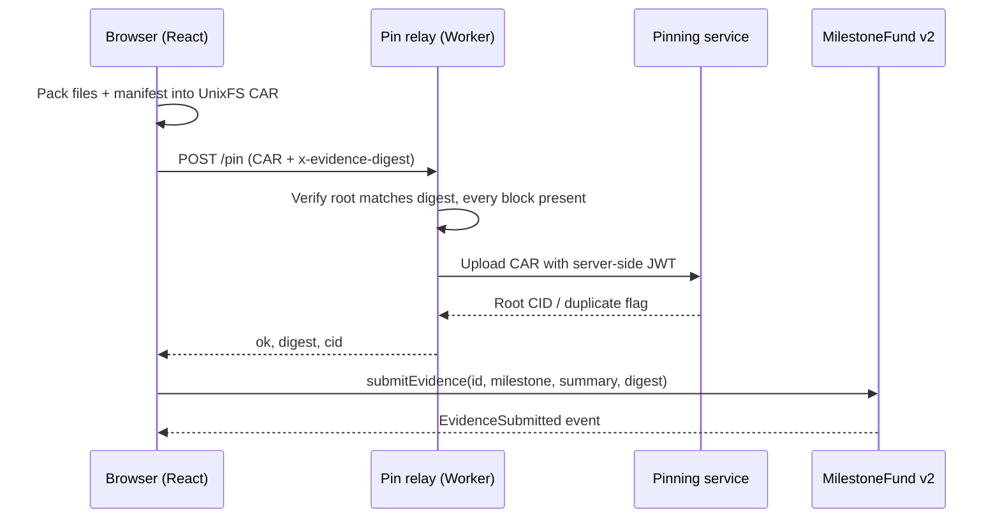

# IPFS evidence specification

This document defines how MilestoneFund v2 replaces mutable evidence URLs with content-addressed IPFS archives, how to reconstruct a CID from the on-chain digest, and how to operate the pinning relay.

## 1. Why content addressing

In v1 each milestone stored an `evidenceUrl` pointing at Google Drive or a web page. The URL stayed fixed while the content behind it could be edited or deleted, and the contract had no way to detect the change. The v2 model instead hashes the evidence itself:

- the browser packs the deliverables into a deterministic UnixFS directory and computes its root CID;
- the contract stores only the 32-byte SHA-256 digest of that root as `bytes32 evidenceCid`;
- anyone can re-fetch the archive, recompute the hash and compare it with the chain.

A changed file changes the root hash, so tampering is detectable. The full CID is never stored on chain — it is reconstructed from the fixed multihash prefix plus the digest.

## 2. Data flow



The pinning JWT exists only as a Worker secret and is never embedded in the browser bundle.

## 3. CID and digest math

Every evidence root uses the same multihash:

| Bytes | Meaning |
| --- | --- |
| `0x12` | multihash code for SHA-256 |
| `0x20` | digest length, 32 bytes |
| 32 bytes | the SHA-256 digest stored on chain |

The on-chain `bytes32` is therefore the multihash with the two-byte prefix removed. Reconstruction is deterministic:

```text
multihash = 0x1220 || evidenceCid
CIDv0     = base58btc( multihash )            // dag-pb codec implied, Qm…
CIDv1     = base32( version 1 + dag-pb + multihash )  // bafy…
```

CIDv0 and CIDv1 are two encodings of the same content. The helper functions are:

- `digestFromCid(cid)` — multihash to on-chain hex;
- `cidFromDigest(hex)` — on-chain hex back to a CID object;
- `cidV0String` / `cidV1String` — encoded forms.

## 4. Packaging parameters

Packaging is implemented in `src/ipfs.js` (`buildEvidencePackage`) and is fixed so the same inputs always yield the same CID:

| Parameter | Value |
| --- | --- |
| Schema version | `EVIDENCE_SCHEMA_VERSION = 1` |
| Root encoding | dag-pb UnixFS directory |
| Hash | SHA-256, multihash prefix `0x1220` |
| Leaf chunk size | `262144` bytes (256 KiB) |
| Directory links | sorted by file name, deterministic byte order |
| Small files | one UnixFS node with inline data (size ≤ chunk size) |
| Large files | raw leaf blocks (`multiformats/codecs/raw`) linked by one UnixFS file node |
| Manifest | `manifest.json`, always present, reserved name |

The manifest records the schema version, the creator summary, an ISO timestamp and each file's name, size and CIDv0. It is packed as an ordinary file and becomes part of the root, so it is covered by the digest.

> The manifest timestamp is informational. The authoritative time for any dispute is the block timestamp of the submission transaction.

The CAR export contains exactly one root and every block reachable from it, with duplicate blocks written once.

## 5. Relay API

The Worker (`worker/src/index.js`) is the only component that holds the pinning credentials.

### `GET /health`

Returns `{ "ok": true }` for uptime checks.

### `POST /pin`

| Header | Required | Purpose |
| --- | --- | --- |
| `x-evidence-digest` | yes | the 32-byte digest as a 0x-prefixed hex string |
| `x-relay-key` | when `RELAY_KEY` is set | shared secret check |
| `Content-Type` | yes | `application/vnd.ipld.car` |

The body is the raw CAR. The handler:

1. rejects an invalid or missing digest header (`400`);
2. parses the CAR and requires exactly one root (`400`);
3. verifies the root digest equals the header (`400`);
4. walks every CID and confirms each block is present (`400`);
5. forwards the CAR to the pinning service and returns the result.

Success response:

```json
{ "ok": true, "digest": "0x…", "cid": "Qm…", "isDuplicate": false }
```

CORS is controlled by the `ALLOWED_ORIGINS` variable (comma-separated). The default allow-list contains the GitHub Pages origin and the local Vite server. The pinning adapter is isolated in `worker/src/pinning.js`; swapping providers means replacing that module only.

## 6. Operator runbook

### 6.1 Pinning account

1. Create a Pinata account and issue an API key scoped to pinning only (no admin or account-management permissions).
2. Keep the JWT secret; it is configured server-side and never committed.

### 6.2 Deploy the Worker

```bash
# one-time authorisation
npx wrangler login

# local development with secrets in worker/.dev.vars (git-ignored)
npm run worker:dev

# production deployment
npm run worker:deploy

# server-side secrets
npx wrangler secret put PINATA_JWT --config worker/wrangler.jsonc
npx wrangler secret put RELAY_KEY  --config worker/wrangler.jsonc   # optional
```

The repository workflow `.github/workflows/deploy-worker.yml` can deploy automatically on changes under `worker/` using the `WRANGLER_API_TOKEN` repository secret.

### 6.3 Deploy the v2 contract

1. Open `contracts/MilestoneFund.sol` in Remix and compile with Solidity 0.8.24.
2. Deploy a fresh instance on Sepolia. This is a new address, not an upgrade of the v1 contract; v1 remains readable at the `v1.0` Git tag.
3. The constructor keeps the submission and approval timeout parameters; set them as needed.
4. Point `VITE_CONTRACT_ADDRESS` at the new address and run `npm run verify:deployment`, expecting an immutable-substitution match.

### 6.4 Configure the frontend

Set in `.env.local` and as GitHub Pages variables:

| Variable | Value |
| --- | --- |
| `VITE_CONTRACT_ADDRESS` | the v2 contract address |
| `VITE_PIN_RELAY_URL` | the deployed Worker base URL |
| `VITE_PIN_RELAY_KEY` | the shared key, if `RELAY_KEY` is configured |
| `VITE_SEPOLIA_RPC_URL` | optional Sepolia RPC |

### 6.5 End-to-end walkthrough

On a funded Sepolia project, as the creator:

1. select the deliverable files and write the summary;
2. run **Package & pin to IPFS**, then **Submit evidence on-chain**;
3. confirm the `EvidenceSubmitted` event and the stored digest;
4. from a backer account use **Verify content** and expect a full-DAG match;
5. proceed to approval and release, keeping the transaction and verification output as evidence.

## 7. Residual trust

- A CID proves integrity — the content has not changed — not authorship, legitimacy or delivery quality. Backers still evaluate the work against the milestone goal.
- Retrieval depends on public gateways and active pinning, both external infrastructure that can be slow, rate-limited or discontinued.
- The relay protects the pinning quota and credentials; its availability is still a single Cloudflare deployment.
- The client manifest timestamp is not authoritative; block timestamps govern all deadlines.
